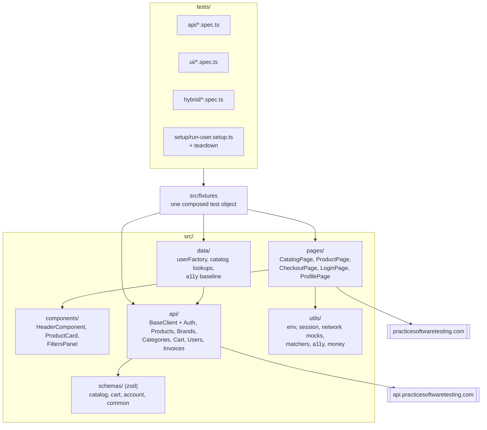
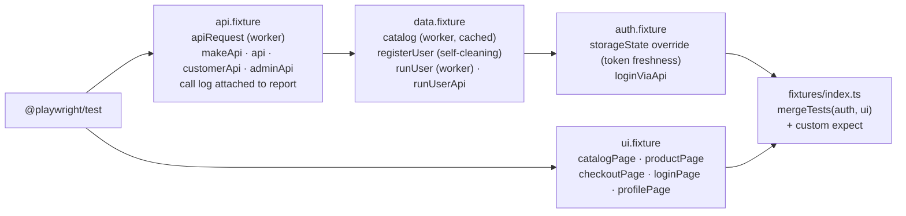
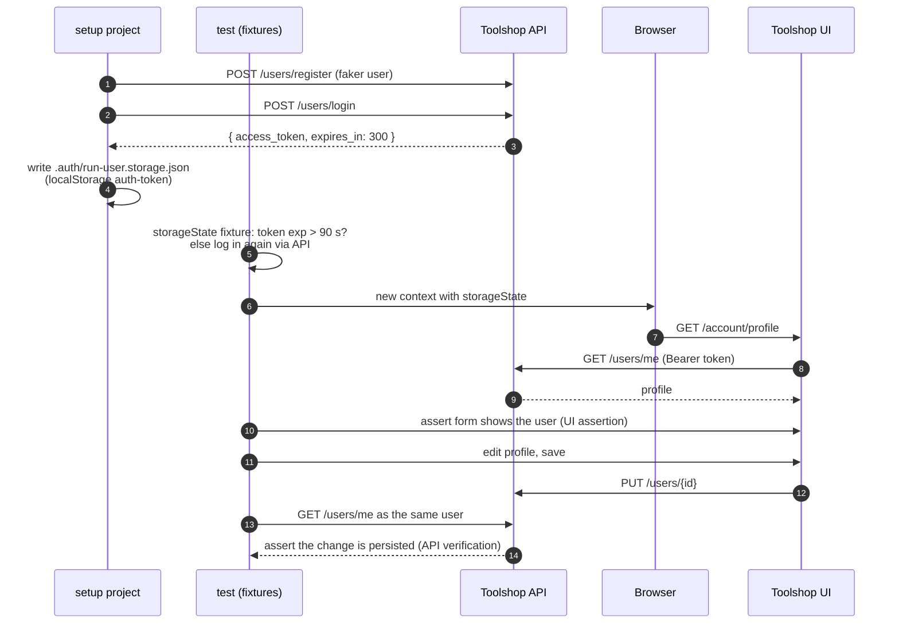
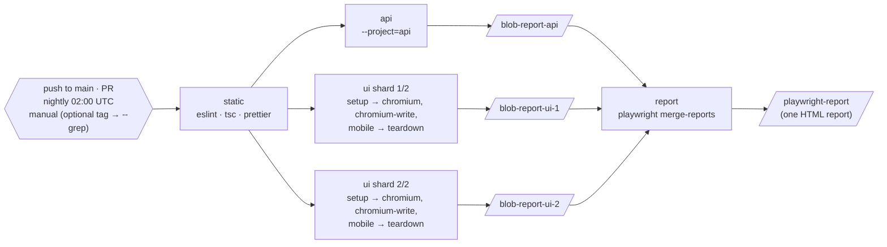

# playwright-api-ui-framework

[](https://github.com/fathirwafda/playwright-api-ui-framework/actions/workflows/playwright.yml)


A layered test framework in **Playwright + TypeScript** that treats the API and the UI as one
system. Typed API clients validate every response against a zod contract; the same clients log the
browser in, build test state and check what the UI saved. UI tests spend their time on the screen
under test instead of clicking through login forms and shopping flows to get there.

The target is [Practice Software Testing "Toolshop"](https://practicesoftwaretesting.com), a public
demo shop with a real REST API ([Swagger](https://api.practicesoftwaretesting.com/api/documentation)).
Everything runs from a fresh clone against the live demo, with no configuration.

## Contents

- [What it shows](#what-it-shows)
- [Tech stack](#tech-stack)
- [Architecture](#architecture)
- [Hybrid API + UI patterns](#hybrid-api--ui-patterns)
- [Test coverage](#test-coverage)
- [Project structure](#project-structure)
- [Quick start](#quick-start)
- [Configuration](#configuration)
- [CI pipeline](#ci-pipeline)
- [Reporting](#reporting)
- [Design decisions](#design-decisions)
- [Known issues found on the target](#known-issues-found-on-the-target)
- [Roadmap](#roadmap)
- [License](#license)

## What it shows

- **A layered framework**: specs → fixtures → page objects / API clients → zod schemas. Specs never
  touch a URL, a selector or a raw JSON payload.
- **Contract testing on every call**: each typed client method parses the response with a zod
  schema and fails with a field-level diff (`data.3.category.slug: expected string, received undefined`).
- **API + UI in one test**: log in through the API and inject the session, seed a cart through the
  API and assert it in the UI, act in the UI and verify the record through the API, and replace API
  responses with `page.route` to reach error and empty states.
- **Playwright features used deliberately**: setup/teardown projects with dependencies,
  storageState, project-level worker limits, tags, `test.step`, soft assertions, custom `expect`
  matchers, `test.fail()` for known defects, blob reports merged across CI shards.
- **Robust against a live, shared, resetting demo**: no hard-coded ids, names or prices; expected
  values come from the API at run time; every record a test creates is cleaned up where the API
  allows it.

## Tech stack

| Area          | Tools                                                                                              |
| ------------- | -------------------------------------------------------------------------------------------------- |
| Language      | TypeScript 6, `strict` + `noUncheckedIndexedAccess`                                                |
| Test runner   | `@playwright/test` 1.65 (browser + `APIRequestContext`)                                            |
| Contracts     | `zod` 4                                                                                            |
| Test data     | `@faker-js/faker`                                                                                  |
| Accessibility | `@axe-core/playwright` (WCAG 2.1 A/AA)                                                             |
| Code quality  | ESLint flat config (`typescript-eslint` strict-type-checked, `eslint-plugin-playwright`), Prettier |
| CI            | GitHub Actions: static checks, API job, UI job sharded 2 ways, merged HTML report                  |

## Architecture

Specs import one `test` object. It is built from four fixture layers, each extending the previous
one, so a spec asks for `catalogPage`, `runUserApi` or `loginViaApi` and gets a ready object.



### Fixture composition



Fixtures are lazy: a test that only names `api` never starts a browser, and a test that never
calls `registerUser` never logs in as admin.

## Hybrid API + UI patterns

### 1. API login, browser session

The web app stores its JWT in `localStorage["auth-token"]` and sends it as a Bearer header; there
is no auth cookie. The `setup` project registers a throwaway user, logs it in through the API and
writes a Playwright storageState containing that token. Tests that `test.use(asRunUser)` open
protected pages directly. Tokens live five minutes, so an override of the `storageState` fixture
checks the token's `exp` claim and logs in again through the API when fewer than 90 seconds remain.



### 2. State seeded through the API

A cart is created with `POST /carts` + `POST /carts/{id}` and the browser is pointed at it with an
init script (the app keeps `cart_id` in sessionStorage, which storageState does not capture). The
test then checks the cart page: lines, quantities, total, badge.

### 3. UI action, API verification

The checkout test places an order in the UI and then reads `GET /invoices` as the same user to
check the invoice exists with the right product, quantity and unit price. The profile test edits
the form and reads the record back through the API.

### 4. Network mocking

The product grid is fed by `QUERY /products` (the app uses the HTTP `QUERY` method with a JSON
body). `mockApi()` intercepts by host, path **and method**, records every hit, and can either
return a fixed reply or edit the real response (`route.fetch()`). Tests cover the empty state, a
500 error, a grid built from an edited response, and recovery after the mock is removed. Each
asserts the mock was hit.

## Test coverage

| Feature                                                        | API | UI  | Hybrid |
| -------------------------------------------------------------- | :-: | :-: | :----: |
| Login, invalid credentials, malformed body                     | ✅  | ✅  |        |
| Token refresh (old token revoked), logout                      | ✅  |     |        |
| Login form validation (required, format, length)               |     | ✅  |        |
| Session from API login, storageState reuse, auth redirect      |     |     |   ✅   |
| Products: paging, page past the end, envelope consistency      | ✅  |     |        |
| Products: search, no results, reset                            | ✅  | ✅  |        |
| Filter by category, brand, price range, rentals                | ✅  | ✅  |        |
| Sorting by price and name, both directions                     | ✅  | ✅  |        |
| Product by id, specs, related products, 404                    | ✅  | ✅  |   ✅   |
| `QUERY` vs `GET` parity (the call the UI makes)                | ✅  |     |        |
| Brands and categories (tree vs flat list, 404)                 | ✅  |     |        |
| Cart: create, add, update, remove, delete, validation          | ✅  | ✅  |   ✅   |
| Checkout as a logged-in customer, invoice in the API           |     | ✅  |   ✅   |
| Registration, profile read/update, duplicate, password policy  | ✅  |     |        |
| Authorisation (other user's data, self-delete)                 | ✅  |     |        |
| Profile edit persisted                                         |     |     |   ✅   |
| Error / empty / edited API responses (mocked)                  |     |     |   ✅   |
| Accessibility (axe) on catalogue, product, login               |     | ✅  |        |
| Mobile viewport: collapsed nav and filters, no sideways scroll |     | ✅  |        |
| Known defects pinned with `test.fail()` / pinned status        | ✅  |     |   ✅   |

Current size: 43 API tests, 36 desktop browser tests (34 parallel + 2 serial write tests, 12 of
them tagged `@hybrid`), 5 mobile tests, plus 1 setup and 1 teardown step. Contract validation runs
inside every typed client call, so it is part of every API, UI and hybrid test that uses the API.

Tags: `@api`, `@ui`, `@hybrid` (layer), `@smoke` (a few critical paths per area), `@a11y`,
`@mobile`, `@write` (changes data on the demo), `@known-issue`.

## Project structure

```text
.
├── .github/workflows/playwright.yml  # static → api + ui (2 shards) → merged HTML report
├── src/
│   ├── api/          # BaseClient (auth header, timing, status + schema check) and one client per resource
│   ├── schemas/      # zod contracts: catalog, cart, account, common (pagination, errors, ULIDs)
│   ├── pages/        # page objects: Catalog, Product, Checkout (4-step wizard), Login, Profile
│   ├── components/   # Header, ProductCard, FiltersPanel (sort, search, checkboxes, price slider)
│   ├── fixtures/     # api → data → auth layers + ui, merged into one `test`
│   ├── data/         # faker user/address builders, live catalogue lookups, a11y baseline
│   └── utils/        # env, session (JWT, storage keys), network mocks, matchers, a11y, money
├── tests/
│   ├── setup/        # run-user.setup.ts (register + API login + storageState), run-user.teardown.ts
│   ├── api/          # auth, products, catalog, cart, users + invoices
│   ├── ui/           # search, filters-sorting, product-detail, cart, checkout, login, accessibility, responsive
│   └── hybrid/       # api-login, api-seeded-state, ui-to-api, network-mocking
├── playwright.config.ts              # projects: api, setup, teardown, chromium, chromium-write, mobile (+ firefox opt-in)
├── eslint.config.mjs
└── tsconfig.json
```

### Projects

| Project                    | Runs                                      | Depends on            | Workers     |
| -------------------------- | ----------------------------------------- | --------------------- | ----------- |
| `api`                      | `tests/api`                               | none                  | max 2       |
| `setup`                    | registers the run user, saves the session | none                  | 1 test      |
| `chromium`                 | `tests/ui` + `tests/hybrid`, not `@write` | `setup`               | parallel    |
| `chromium-write`           | `@write` browser tests (orders, profile)  | `setup`               | 1           |
| `mobile`                   | `@mobile` tests on a Pixel 7 viewport     | none                  | parallel    |
| `teardown`                 | deletes the run user                      | (teardown of `setup`) | 1 test      |
| `firefox`, `firefox-write` | same as chromium, only with `FIREFOX=1`   | `setup`               | as chromium |

## Quick start

Requirements: Node.js 20 or newer (`.nvmrc` pins 20).

```bash
npm ci                                    # or: npm install
npx playwright install chromium           # add --with-deps on a fresh Linux machine

npm test                                  # api, chromium, chromium-write, mobile
npm run test:api                          # API only, no browser needed
npm run test:ui                           # UI + hybrid on desktop Chromium
npm run test:hybrid                       # only the @hybrid tests
npm run test:mobile                       # Pixel 7 viewport
npm run test:smoke                        # @smoke across api and chromium
npm run test:a11y                         # axe scans
npm run test:firefox                      # after: npx playwright install firefox
npm run report                            # open the last HTML report

npm run lint && npm run typecheck && npm run format:check
```

Filter by tag with `--grep`, for example `npx playwright test --project=chromium --grep @hybrid`
or `--grep-invert @known-issue`.

## Configuration

Every setting has a default that points at the public demo, so no configuration is needed. To
override, export the variable or put it in a local `.env` file (gitignored; there is deliberately
no `.env.example` in the repo, this table is the reference).

| Variable            | Default                                   | Used for                                                    |
| ------------------- | ----------------------------------------- | ----------------------------------------------------------- |
| `UI_BASE_URL`       | `https://practicesoftwaretesting.com`     | browser projects                                            |
| `API_BASE_URL`      | `https://api.practicesoftwaretesting.com` | API clients, network mocks                                  |
| `CUSTOMER_EMAIL`    | `customer@practicesoftwaretesting.com`    | read-only checks as the demo customer                       |
| `CUSTOMER_PASSWORD` | `welcome01`                               | as above                                                    |
| `ADMIN_EMAIL`       | `admin@practicesoftwaretesting.com`       | cleanup: deleting users the tests registered                |
| `ADMIN_PASSWORD`    | `welcome01`                               | as above                                                    |
| `API_SLOW_MS`       | `2000`                                    | soft response-time budget per call                          |
| `FIREFOX`           | unset                                     | `1` adds the Firefox projects                               |
| `CI`                | unset                                     | retries 2, 2 workers, blob + GitHub reporters, `forbidOnly` |

The demo accounts are published by the site itself for practice; they are not secrets. Tests that
change data never use them: they register their own users.

## CI pipeline



- The manual `tag` input reaches the shell through `env`, never through `${{ }}` inside `run`, so
  it cannot inject commands.
- `fail-fast: false` on the shards and `if: !cancelled()` on uploads and the merge job: one failing
  job still produces the full report.
- Each shard runs the `setup` project for its own tests and registers its own run user, so shards
  never share a session.
- Action majors are pinned: `actions/checkout@v4`, `actions/setup-node@v4`,
  `actions/upload-artifact@v4`, `actions/download-artifact@v4`.

## Reporting

- **Local**: `list` in the terminal and an HTML report in `playwright-report/` (`npm run report`).
- **CI**: blob reports per job, merged into one HTML report artifact, plus GitHub annotations.
- **Steps**: multi-stage tests use `test.step`, so the report reads like the scenario.
- **API call log**: every test that used an API client gets an `api-calls.json` attachment
  (method, path, status, duration).
- **Accessibility**: `axe-results.json` attached per scan, one annotation per violation.
- **Known issues and cleanup**: `known-issue` and `cleanup` annotations show in the report.
- **Failures**: screenshot and trace kept for every failed test; video recorded on the first retry.

## Design decisions

**Typed clients + zod, not raw `request.get()`.** A spec that calls `api.products.search('pliers')`
gets a typed body or a failure that names the endpoint, the status and the broken fields. The
schemas are the single source of truth for both the runtime check and the TypeScript types. Where
endpoints return different shapes for the same resource (search drops `category.slug`, cart lines
drop the image), the schemas derive explicit variants (`SearchProductSchema`, `CartProductSchema`)
instead of loosening everything with `.optional()`, so the difference is documented and enforced.
Negative tests use `raw*` methods that return the untouched response.

**Fixtures over base classes.** There is no `BaseTest` or `BasePage` inheritance chain. Each
capability is a fixture, fixtures depend on each other explicitly, and `mergeTests` combines
independent layers. A spec declares what it needs in its signature, setup and cleanup live next to
the thing they manage (`registerUser` deletes its users after the test whatever the outcome), and
nothing is built that a test does not use.

**Log in through the API.** Only `tests/ui/login.spec.ts` uses the login form. Everywhere else the
session comes from `POST /users/login`, which is faster, does not repeat the login flow in every
test, and removes a whole class of flakiness. The run user is registered per run, so tests that
place orders or edit a profile never touch accounts other people share.

**Mocking strategy.** Mocks cover what the live system cannot produce on demand: errors, empty
results and specific data. They match on method as well as path (the app uses `QUERY /products`
for the list and `GET /products/{id}` for details), assert they were hit, and prefer editing a real
response over inventing one, so the mocked payload keeps the real contract. Everything else runs
against the real API.

**Data that survives a reset.** The demo reseeds its database regularly and every id changes (see
known issues). Tests ask the API for "an in-stock product", "the brands", "the cheapest product
with specs" at run time, and find UI checkboxes by label, not by `data-test="category-<id>"`. The
only constants are slugs and a search term.

**Flakiness strategy.**

- UI actions that trigger a request wait for that response (`waitForApi`), then assertions use
  web-first matchers; there are no fixed sleeps.
- Selectors: the site's `data-test` attributes (`testIdAttribute: 'data-test'`), roles and labels.
- Isolation: fresh browser context per test; carts and users are created per test; data-changing
  browser tests run in a single-worker project; API concurrency is capped at 2.
- Token expiry is handled by the `storageState` fixture, not by retries.
- CI retries twice with traces and video, so a flaky test is reported as flaky, not hidden.
  Locally there are no retries.

**Known defects as tests.** A known defect is asserted as correct behaviour and marked
`test.fail()`: it passes while the bug exists and turns red when it is fixed, so the note cannot
go stale. Where the defect is a status code, the current code is pinned and annotated.

**Accessibility gate.** We do not own the site, so axe scans fail only on critical violations that
are not in `src/data/a11yBaseline.ts`, and a soft check reports baseline entries that no longer
reproduce. Serious and lower findings are reported, not blocking.

**Politeness.** One worker for browser tests that write data, two for the API project, no load of
any kind, and cleanup through the admin account for every user the suite registers.

## Known issues found on the target

Observed while building the suite (November 2026). Some are probably deliberate: the site exists
for practice.

| Area | Behaviour                                                                                                                         | How the suite handles it                                                                         |
| ---- | --------------------------------------------------------------------------------------------------------------------------------- | ------------------------------------------------------------------------------------------------ |
| Data | The database is reseeded regularly; all product, category and brand ids change                                                    | Nothing hard-coded; expectations come from the API at run time                                   |
| Data | Category "Storage Solutions" has the slug `storage solutions` (with a space)                                                      | `test.fail()` known-issue test                                                                   |
| API  | `GET /products?sort=bogus,asc` returns `500 Something went wrong` instead of a 4xx                                                | Status pinned, `known-issue` annotation                                                          |
| API  | Error bodies come in four shapes: `{error}`, `{message}`, `{message, errors}`, and a bare field map (registration)                | One zod schema per shape                                                                         |
| API  | An empty login body answers `401`, not `422`                                                                                      | Asserted explicitly, with a comment                                                              |
| API  | Reading another user answers `404 "You are not authorized to view this user."` rather than `403`                                  | Asserted explicitly, with a comment                                                              |
| API  | Search and related-products responses omit `category.slug`; related omits `co2_rating`; cart lines omit image, brand and category | Explicit schema variants per endpoint                                                            |
| API  | Tokens expire after 300 s; `GET /users/refresh` revokes the old token                                                             | Tested; storageState fixture re-logs in when a token is stale                                    |
| API  | Users who own invoices cannot be deleted (`409`)                                                                                  | The run user that placed an order stays until the next reset; reported as a `cleanup` annotation |
| API  | The user record tracks `failed_login_attempts`                                                                                    | Negative login tests use non-existent emails, never the shared demo accounts                     |
| API  | Occasional slow responses (one call took 8 s) and, once, `Cart not found` for a cart created moments earlier (not reproduced)     | Generous timeouts; CI retries                                                                    |
| UI   | The product list uses the HTTP `QUERY` method with a JSON body                                                                    | `ProductsClient.query()` and method-aware mocks                                                  |
| UI   | When `QUERY /products` fails, the grid is just empty: no message, no retry                                                        | `test.fail()` known-issue test, plus a test that the page stays usable                           |
| UI   | `data-test="filters"` is used on both the mobile toggle button and the panel                                                      | Locators scope by tag (`button[...]`, `div[...]`)                                                |
| UI   | Related-product cards have no `data-test` attribute                                                                               | Located by `a.card[href^="/product/"]`                                                           |
| UI   | Header still shows the old first name right after a profile update, until reload (seen once manually, not covered by a test)      | Not asserted                                                                                     |
| A11y | Login: the show/hide password button has no accessible name (critical, `button-name`)                                             | In the a11y baseline                                                                             |
| A11y | Language button label does not match its text; filter lists contain non-`li` children (serious)                                   | Reported, not blocking                                                                           |

## Roadmap

- Generate the client method signatures from the OpenAPI spec and keep zod for runtime checks.
- Run the Firefox projects on the nightly schedule.
- Contract drift job: diff the Swagger document against the zod schemas and open an issue on change.
- Visual comparison of a few key components inside the Playwright Docker image, with committed
  Linux baselines.
- Favourites and invoice PDF download (both have API endpoints, no coverage yet).

## License

[MIT](LICENSE) © 2026 Fathir Wafda
